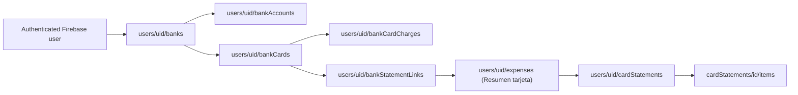

# LTC$ Banking workspace

The new `/bancos` authenticated route is a manual financial registry that complements **Transacciones** (accounting movements) and **Portfolio** (investments). It never connects to any bank's online banking and does not request banking passwords, complete credit-card numbers, or CVV.

## Domain and Firestore structure

- `banks`: owner-created institutions with user-entered names and Firestore-generated IDs. No default banks are seeded, and any institution can be added manually. Existing legacy IDs such as `santander` and `ciudad` remain valid.
- `bankAccounts`: account nickname, type, ARS or USD, manually entered current balance, optional alias and CBU/CVU. CBU is masked in the UI unless explicitly revealed.
- `bankCards`: bank ID, nickname, brand, **last four digits only**, usual closing day and due day. Actual closing/due dates are saved **per statement**, not inferred from these days.
- `bankCardCharges`: explicitly created manual purchases (amount, currency, merchant, date, installments) with `countedInCashFlow: false`. They are **NOT** inserted into `expenses`.
- `bankStatementLinks`: one document per existing expense ID, containing only bank ID, card ID and last update. This avoids rewriting previous expenses or altering the canonical category schema. Firestore rules verify that the expense belongs to the user and is a `Resumen tarjeta`, and the card belongs to the selected bank.
- Existing PDF details under `cardStatements/{fileSha256}/items` remain canonical; the banking UI reads existing statements. Users may link a previously imported statement without reimporting or double counting.

## Credit-card statement workflow

1. From **Bancos**, create the bank profile and the appropriate Visa/Mastercard/etc. card.
2. Expand the card and select **Importar resumen PDF**. This reuses the existing `CardStatementPdfReview` analyzer for currently supported PDFs (Visa Santander and Banco Ciudad). Review its extracted data and category suggestions, then explicitly confirm.
3. The application checks the PDF SHA-256 against existing imported statements. If already present, reuse its existing expense; otherwise create exactly one `Resumen tarjeta` transaction with its ARS amount, and save the detailed imported statement using `saveReviewedStatement`. The selected bank/card are recorded via `bankStatementLinks`. Purchase details remain excluded from cash-flow totals.
4. From **Transacciones**, a `Resumen tarjeta` form also offers **Banco y tarjeta**, with the same relationship. Legacy summaries can be linked later from the **Resúmenes importados sin vincular** section.

A manually entered purchase and a statement PDF may describe the same real-world purchase. Do not aggregate their amounts: display them as separate sources to be reviewed and reconciled in a future release.

Never add all ARS and USD into one total without an explicit FX rate; do not treat purchases or credit-card payments as investment losses.

## Deployment and security

**The repository fragments are not deployed automatically.** Merge `firestore.rules.banks` **inside the existing** `match /databases/{database}/documents`, keeping all other Firestore rules. Verify in the Rules Playground or Emulator:

- owner create/list/read/update of bank profiles, accounts, cards and charges succeeds;
- another signed-in user or an unauthenticated user is denied;
- attempted writes containing PAN, CVV, authentication secrets or unexpected fields are denied;
- a link to a different user's expense, a non-statement category, a missing card, or a card from another bank is denied;
- bank charges cannot mark themselves as counted in cash flow;
- direct card/charge deletion is disabled as specified, except manually created charges.

The existing card-statement rules must already be deployed and allow the approved PDF analysis workflow. No new Firebase Functions and no paid Firebase features are required.

Release order: publish/test the revised additive rules, verify CI and a Vercel preview, then merge and confirm the production commit. Vercel does not deploy Firestore rules automatically. Until rules are deployed, the banking page will show a Firestore permission error rather than silently omitting data.

## Future enhancements

- Bank-account balance history: never infer earnings or income merely from a changing balance.
- Reconciliation UI to match manual purchases against imported statement items without duplicating either.
- More issuer and PDF format adapters.
- Financial data export via the shared LTC$ PDF/Excel/CSV module once account and card reports are ready.

## Better card and existing-PDF linking UX

The **Vincular resúmenes a tarjetas** section is an action-oriented, optionally collapsible list (expanded by default), not an analytics report. A pending PDF remains an existing card-statement expense and is never reimported simply because the user links it. An exact normalized bank + unique matching card brand can propose a card, but the user must explicitly choose **Usar sugerencia** and **Confirmar asociación**. If the institution or brand is ambiguous, the user chooses manually. A bank-card details view links to the outstanding queue. The existing owner-scoped `bankStatementLinks` Firestore security and single-source-of-truth expense behavior remain unchanged.

## Correcting or removing an incorrect card-statement association

A statement already linked to a bank/card has a **Corregir vínculo** action on its
card in `/bancos`. Its mobile-friendly dialog displays the current bank and card,
allows selecting another bank and one of its cards, and offers **Desvincular
resumen** with an explicit second confirmation. The save action is disabled
until both a valid new bank/card are selected and the destination differs.

- `reassignStatementBankLink(uid, expenseId, bankId, cardId)` verifies the
  signed-in owner, target bank, card ownership and an existing `Resumen tarjeta`
  expense, then updates **only** the existing
  `users/{uid}/bankStatementLinks/{expenseId}` document. An `update()` never
  recreates a link removed from a second device.
- `unlinkStatementBank(uid, expenseId)` verifies owner/document and deletes
  **only** that link. Real-time subscriptions automatically remove the PDF from
  the old card. The PDF/expense then appears in the existing pending-association
  queue, where the user can explicitly associate it again.
- Neither action touches `expenses`, `cardStatements`, or nested PDF `items`,
  nor inserts `bankCardCharges`; no duplicate spending can be generated.
- Firebase's additive `firestore.rules.banks` already has validated
  `create, update` and owner-only `delete` for `bankStatementLinks`.
  Ensure that fragment is actually published in the active Firebase project;
  **do not** add a permissive second match or replace unrelated rules.
- QA: move a PDF to a different bank/card; move within one bank; verify
  both old/new card lists; unlink and find it in the pending queue; attempt
  cross-user writes, invalid card/bank pairs, missing links, and error handling.

## Spending guardrail notifications and private Lita context

The user can configure an owner-scoped limit for **ARS** and **USD** and a
warning threshold (50-95%, default 80%) via the **Alertas de gastos de tarjetas**
card in Bancos. Real-time subscriptions power a dedicated bank-alert section
inside the global notifications bell. Warnings and maximum breaches have
separate identifiers per month and currency, acknowledged in browser
localStorage; no amounts or financial names are cached there.

The alert evaluates *manual purchases entered during the current calendar
month*, minus purchases already covered by a linked imported PDF closure for
that specific card. All banks are included, but ARS/USD remain separate.
It does not add home-banking snapshots or already-paid statement expenses.
This is only a partial register, not a bank-authoritative total. In-browser
toast and optional native browser notification (with user-granted permission)
work while LTC is open. Background push notifications with app closed require
a separate push service and are not claimed here.

The history graph/high-low panel uses imported, approved and **linked** PDF
summaries. Deduplicate by expenseId; use `purchases` per native currency,
falling back to `totals` only with an explicit "estimated" flag. A month
without a valid PDF is *missing*, never a zero-spending month. A numerical
reference of 90% of average of up to six statement months is only an initial
suggestion, never an automatically applied or guaranteed maximum.

Press **Consultar a Lita sobre mis topes** to open the existing
`section=banks` assistant. The client passes a sanitized `monthlyCardSpending`
context containing up to 18 periods per currency, highs/lows, averages and
budget status. Lita cannot update Firestore or see sensitive banking IDs,
account numbers, CBU/CVU, CVV or full card numbers.

Date estimates shown for each card use the registered typical closing and
due days with end-of-month clamping; authoritative future bank-provided
snapshot dates take priority. A projected date is marked estimated.

Before merging: add only `firestore.rules.bankSpendingBudgets` into the
existing Firestore owner rules. Do not replace unrelated matches. Verify
create/read/update for the owner and deny cross-user/invalid writes. A rules
deployment is not available through GitHub or Vercel in this repository.

## ChatGPT screenshot-to-Markdown card spending import (PR #215)

This user workflow deliberately uses ChatGPT **outside** LTC to read user-supplied
home-banking screenshots; LTC never runs OCR or sends screenshots to Lita.
The `src/components/CardConsumptionMarkdownImporter.js` dialog provides a
copyable prompt, a strict Markdown parser with preview, explicit bank/card
selection on every record, and explicit final confirmation. The user should
obscure PAN, CBU, CVV and credentials before uploading screenshots.

`- type: snapshot` represents the bank's **current aggregate card consumption**
as of `fechaConsulta`; fields `consumosARS`, `consumosUSD`, `cierre`,
`vencimiento` are independently optional except for the date and at least
one consumption amount. A snapshot atomically **replaces** the current
`statementSnapshot` reference on the selected existing `bankCards` record.
Unknown or older currency totals do not get copied to a newer as-of date,
and an older screenshot cannot overwrite newer card consumption data.
It does not create a charge or a transaction and is never added to historic
imported PDF purchases.

`- type: charge` represents an **individual confirmed purchase** only when
the screenshot actually lists one: commerce, date, currency, amount, and
installments, optional operation reference. Approved purchases are stored in
existing `bankCardCharges` with `countedInCashFlow:false` and
`source:manual`. If a PDF contains that purchase or it is already covered
by the latest bank screenshot totals, its amount is **not added again** to
the alert baseline. Existing nearly identical charges are flagged and
blocked in UI; deterministic SHA-256 owner-scoped imported document IDs and
a Firestore transaction make exact Markdown retries idempotent across devices.
The optional reference disambiguates legitimate distinct purchases that
would otherwise look identical. Imports are limited to 10 items and are
atomic, so they either commit all reviewed entries or none.

An alert's "current spending" sums the freshest `currentConsumptionARS/USD`
per card only when its `asOf` is within the current estimated card closing
cycle, plus strictly **later-dated** manual purchases not already in that
snapshot. It never sums a bank snapshot with all preceding manual charges,
nor adds historic summary PDFs to current spending. Cards with no screenshot
fall back to manually recorded purchases in their open cycle. Both figures
can be incomplete; historical PDF months and bank card cycles are not
perfectly aligned.

The separate **historical maximum** signal compares the partial,
cross-bank per-currency current cycle to the highest eligible monthly
aggregate from linked reviewed statement PDFs, with warnings at 80%, 95%
and 100% of that reference. Historical peaks are not affordability targets.
The user can pick a more conservative personal budget after consulting
Lita's existing LLM providers. Warnings are deterministic and require
an open LTC session; no LLM call is triggered on every card purchase.

No new Firestore fields or collections are required for the screenshot
importer; it uses existing bankCards update and bankCardCharges create rules.
The separate owner-only `bankSpendingBudgets` rules fragment is still the
manual release gate for the **new configurable budgets** in PR #215.
