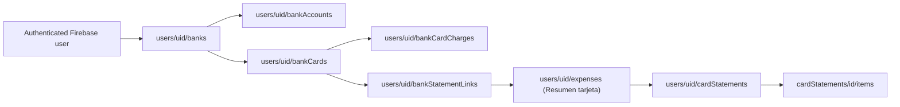

# LTC$ Banking workspace

The new `/bancos` authenticated route is a manual financial registry that complements **Transacciones** (accounting movements) and **Portfolio** (investments). It never connects to Santander or Banco Ciudad's online banking and does not request banking passwords, complete credit-card numbers, or CVV.

## Domain and Firestore structure

- `banks`: deterministic `santander` and `ciudad` documents, created only after the user taps **Agregar banco**, with no global bank/profile records.
- `bankAccounts`: account nickname, type, ARS or USD, manually entered current balance, optional alias and CBU/CVU. CBU is masked in the UI unless explicitly revealed.
- `bankCards`: bank ID, nickname, brand, **last four digits only**, usual closing day and due day. Actual closing/due dates are saved **per statement**, not inferred from these days.
- `bankCardCharges`: explicitly created manual purchases (amount, currency, merchant, date, installments) with `countedInCashFlow: false`. They are **NOT** inserted into `expenses`.
- `bankStatementLinks`: one document per existing expense ID, containing only bank ID, card ID and last update. This avoids rewriting previous expenses or altering the canonical category schema. Firestore rules verify that the expense belongs to the user and is a `Resumen tarjeta`, and the card belongs to the selected bank.
- Existing PDF details under `cardStatements/{fileSha256}/items` remain canonical; the banking UI reads existing statements. Users may link a previously imported statement without reimporting or double counting.

## Credit-card statement workflow

1. From **Bancos**, create the bank profile and the appropriate Visa/Mastercard/etc. card.
2. Expand the card and select **Importar resumen PDF**. This reuses the existing `CardStatementPdfReview` analyzer for currently supported PDFs (Visa Santander and Banco Ciudad). Review its extracted data and category suggestions, then explicitly confirm.
3. The application checks the PDF SHA-256 against existing imported statements. If already present, reuse its existing expense; otherwise create exactly one `Resumen tarjeta` transaction with its ARS amount, and save the detailed imported statement using `saveReviewedStatement`. The selected bank/card are recorded via `bankStatementLinks`. Purchase details remain excluded from cash-flow totals.
4. From **Transacciones**, a `Resumen tarjeta` form also offers **Banco y tarjeta**, with the same relationship. Legacy summaries can be linked later from the **Resúmenes importados sin vincular** section.

A manually entered purchase and a statement PDF may describe the same real-world purchase. Do not aggregate their amounts: display them as separate sources to be reviewed and reconciled in a future release.

Never add all ARS and USD into one total without an explicit FX rate; do not treat purchases or credit-card payments as investment losses.

## Deployment and security

**The repository fragments are not deployed automatically.** Merge `firestore.rules.banks` **inside the existing** `match /databases/{database}/documents`, keeping all other Firestore rules. Verify in the Rules Playground or Emulator:

- owner create/list/read/update of bank profiles, accounts, cards and charges succeeds;
- another signed-in user or an unauthenticated user is denied;
- attempted writes containing PAN, CVV, authentication secrets or unexpected fields are denied;
- a link to a different user's expense, a non-statement category, a missing card, or a card from another bank is denied;
- bank charges cannot mark themselves as counted in cash flow;
- direct card/charge deletion is disabled as specified, except manually created charges.

The existing card-statement rules must already be deployed and allow the approved PDF analysis workflow. No new Firebase Functions and no paid Firebase features are required.

Release order: publish/test the additive rules, verify CI and a real Netlify preview (beware the account build quota), then merge and confirm the production commit. Until rules are deployed, the banking page will show a Firestore permission error rather than silently omitting data.

## Future enhancements

- Bank-account balance history: never infer earnings or income merely from a changing balance.
- Reconciliation UI to match manual purchases against imported statement items without duplicating either.
- More issuer and PDF format adapters.
- Financial data export via the shared LTC$ PDF/Excel/CSV module once account and card reports are ready.
