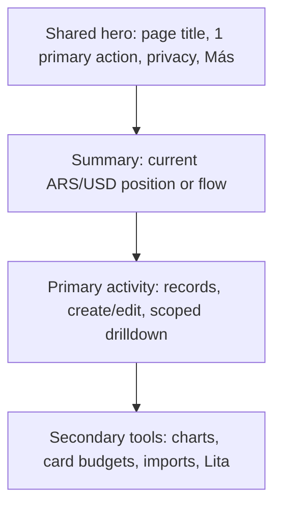

# LTC$ financial UI contract — Transactions is the design source of truth

**Decision (21 Oct 2026):** The user requires **one consistent interface**, not different visual systems for Transactions, Banks, Portfolio and Lita. Treat the current authenticated `/transacciones` page as the reference implementation. When building another surface, **reuse its actual components, tokens, geometry, hierarchy and interaction contracts**. Do not invent a new card, heading or action pattern for each page.

## Reference components (not illustrative examples)

| Visual responsibility | Actual component / token | Transaction baseline | Banks counterpart |
| --- | --- | --- | --- |
| Page shell | `FinancialPageLayout` and `QuickAccessCard` | One title, one primary action | Same components, bank-specific wording only |
| Primary/secondary actions | `FinancialHeaderActions` | Add movement + privacy + **Más** | Add bank + privacy + **Más**, identical DOM/styles |
| Root widget | `CollapsibleSection` and `COLLAPSIBLE_SURFACE_STYLES.root` | Summary, activity, charts | Bank balance, banks activity, budgets, linked statements |
| KPI values | `FinancialMetricCard` | Financial summaries | Two separate balance currencies |
| Card surface | `FINANCIAL_ITEM_SURFACE_STYLES` | Transaction card | Bank account card and consumption card |
| Per-record disclosure | `FINANCIAL_RECORD_DISCLOSURE_STYLES` | **Ver detalles / Ocultar detalles** | Bank account metadata `Ver detalles`; CBU still needs a second explicit reveal |
| Destructive action | `GenericModal` + validated confirmation | DeleteTransactionDialog | DeleteBankChargeDialog |
| Theme | `html.dark` + slate/violet tokens | Opaque slate-800 outer, slate-900/70 inset | Exactly the same |
| Interaction baseline | 44px targets, focus rings, wrapping, skeletons, privacy | Transactions | Same |

## Page-level scan path

At **390px mobile**, read top-to-bottom in that order. At **1440/1728px**, use a single `lg:grid-cols-3` dashboard: summary and tools in the narrow rail, activity in `lg:col-span-2 lg:row-span-2`. This is the existing `Dashboard.js` pattern, not a new Banks-specific composition.

Banks must not put an oversized card-budget settings UI above the user's bank records. Bank account cards must first show title, currency, balance and type. Less-common account identity fields belong under the **same** progressive-disclosure surface as Transactions; sensitive CBU remains masked unless explicitly revealed. Never silently alter persisted records.

## Page-specific semantics stay page-specific

- Transactions totals count income/expense/FX; bank balances are **manual snapshots** and cannot be summed across ARS/USD or interpreted as spending.
- Banks' manual card consumptions **do not create Transactions expenses**; linked statement PDFs and imported transactions must not be duplicated.
- Portfolio withdrawals/transfers aren't losses; earned values reported by the user aren't audited gains.
- Lita uses a conversation UI, but its host header, typography, buttons, surface hierarchy, empty/loading/error/scroll states must follow LTC's shared design language.

## Release gate

1. Inspect **both** `Dashboard.js` and target page before touching styles. Reuse shared primitives before creating a new component.
2. Run cross-page regression tests (`TransactionsHeaderActions.test.js`, `FinancialHeaderActions.test.js`, `Banks.test.js`, `Card.test.js`). A new page **cannot copy/paste** a different set of styles to recreate a similar header.
3. Review actual authenticated screenshots **side by side** of the same content states at 390, 1440 and 1728px, light/dark, before describing a visual redesign as complete. Public sign-in screens don't count.
4. Validate accessibility with named 44px controls, contrast and keyboard focus; document Better Design's code/copy findings honestly. Source-only code review is not a screenshot.
5. Avoid Firestore/schema changes, numeric calculations or new UX features while standardizing visual design.

**Applied in Banks #227 phase 2:** the existing one-off bank header was replaced with `FinancialHeaderActions`, core widgets reordered as Summary → Banks activity → Card spending tools, and account record details changed to the same disclosure style used by Transactions. PDF and card-specific flows remain intact for dedicated future review.
