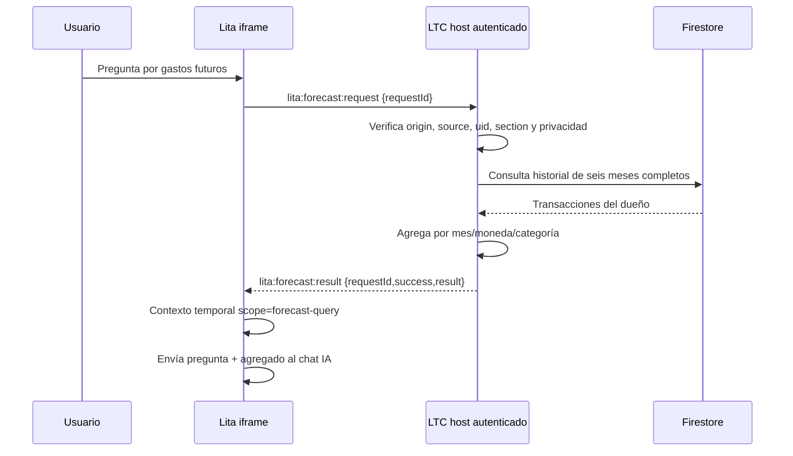

# Lita: forecasts from recorded spending

This is a **read-only and on-demand** feature of the LTC Transactions page, not a scheduled budget, investment recommendation, or automatic transaction.

## Data contract

- Only the **signed-in LTC host** queries `users/{uid}/expenses` in Firestore through the existing browser Firebase SDK and user-scoped rules.
- The six **finished calendar months** preceding today are queried (`selectedDate` sorted descending), limited to 1,201 rows. If more than 1,200 matching records exist, reject the forecast instead of extrapolating partial data.
- The calculator receives the full personal/shared category definitions including archived labels, so old transactions remain classified. A missing category is counted as unclassified and excluded, never treated as income or zero.
- `transactionCurrency` is the immutable native currency; legacy transactions without that field are **ARS**. No ARS/USD conversion is inferred.
- Count only expense-category transactions with positive valid amounts, separately for each month/currency. Incomes are tracked separately only to support a *possible monthly saving* estimate. Treat `Compra/Venta/Ingreso divisas`, transfers between accounts and investment deposits/withdrawals as movements, not income/consumption.
- Recorded credit-card statement payments are included once through the Transactions expense record; **never add** imported PDF purchases, bank consumption snapshots, manual bank charges or bank account balances.
- Month without any expense record is **unknown, not zero**. At least 3 observed months are required for each currency. Current incomplete month is always excluded.

## Calculation

For each currency independently:
1. Select the last 3 months with at least one valid recorded expense inside the six-month window, earliest to latest.
2. Base monthly amount = weighted mean of those three monthly expense totals with weights **1, 2, 3**, rounded to cents.
3. Low/high = minimum/maximum of all available observed monthly expense totals, not percentiles and not a statistical confidence interval.
4. Future 1, 3 and 6-month scenarios = monthly low/base/high multiplied by horizon. **Nominal amounts only**: no assumed inflation, interest rates, changes in income or seasonality.
5. If at least 3 observed income months also exist, possible monthly saving = estimated income base minus expense base. Negative values are possible and should be described as a shortfall.
6. Categories are included as historical expenditure totals for the six-month window; they are not forecasts of specific future bills or installments.

The fields in `spendingForecast` passed to Lita are aggregate-only. The iframe has no Firestore credentials. Sensitive transaction descriptions, receipt numbers and bank identities are never included in this new forecast response.

## Parent ↔ iframe

A request from another origin/source, when `privacyHidden=true`, from a different section, or without a signed-in user is rejected **before Firestore is queried**. If the query is too large, times out or fails, no estimate is fabricated.

## Deployment and QA

1. Deploy the LTC host first (it recognizes the new message, while old Lita keeps working).
2. Deploy the Lita iframe second, with `NEXT_PUBLIC_LITA_PARENT_ORIGINS` including the actual LTC Vercel origin.
3. Run `CI=true npm test -- --watch=false --runInBand src/utils/litaSpendingForecast.test.js src/components/LitaAssitantPanel.test.js` and the full build.
4. Manually validate on a signed-in account: 390px and desktop, light/dark, privacy mode, low-history accounts, old ARS records, distinct USD transactions, linked card PDF details and iframe origin restrictions.
5. The provider's answer is **not** a verified forecast until the signed-in cross-app smoke test has passed. This feature does not change Firestore rules or create new records.
